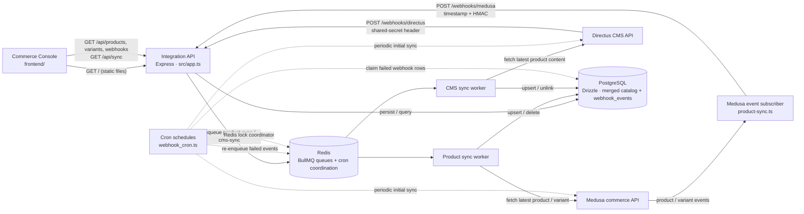
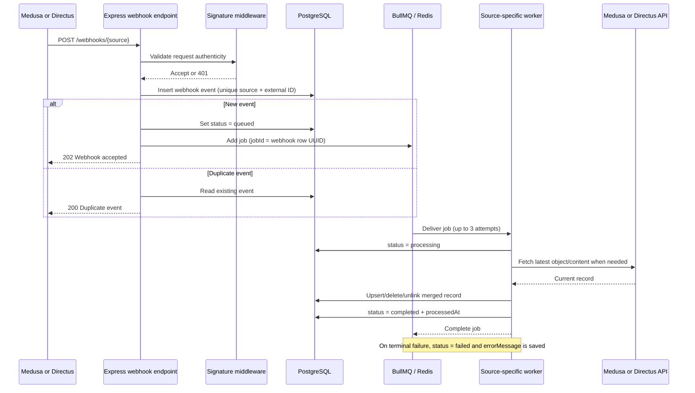
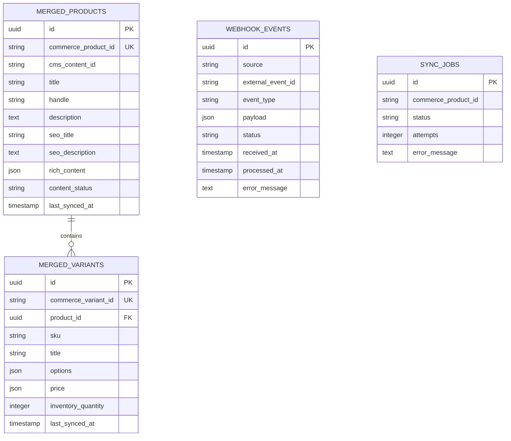

# Commerce Integration — System Design

This document describes the application represented by the root `src/` and
`frontend/` directories, plus the Medusa backend subscriber in
`my-medusa-store/apps/backend/`. It separates implemented behavior from
runtime wiring that is not currently connected.

## 1. System at a glance



**Important runtime distinction:** `src/app.ts` starts Express and imports both
workers, but does not import `src/crons/webhook_cron.ts`. Therefore, the cron
jobs shown above are defined in the code but will not run just by starting
`src/app.ts`; they need a separate process/entrypoint or an explicit import.
The Docker Compose setup below runs the cron in its own service.

The `my-medusa-store` folder is a separate Medusa DTC starter. Its
`product-sync.ts` subscriber sends Medusa product and variant events to the
integration API. The integration itself calls Medusa's Admin API and Directus'
Items API to fetch current records; it does not rely on webhook payloads being
complete.

## 2. Components and responsibilities

| Component | Responsibility | Why it exists |
|---|---|---|
| Commerce Console (`frontend/`) | Displays merged products, variants, content status, and webhook activity; can request a full sync. | Gives operators a read-oriented view and a manual sync control. |
| Express integration (`src/app.ts`) | Serves the console, captures raw request bytes, mounts `/webhooks` and `/api` routers, and starts workers. | One HTTP boundary for the dashboard and inbound events. |
| Webhook routes/controllers | Verify source authenticity, normalize provider-specific payloads, and return `202` after accepting/enqueuing an event. | Keep event ingestion separate from the slower synchronization work. |
| Webhook service/repository | Inserts a durable event record, deduplicates by source + external event ID, updates status, and enqueues the matching job. | Preserves an event trail and avoids processing an already accepted delivery twice. |
| BullMQ queues (`src/queue/`) | `product-sync` and `cms-sync` queues backed by Redis. | Decouples webhook response time from external API and database work. |
| Workers (`src/workers/`) | Fetch the current provider record, apply create/update/delete/unlink operations, and update webhook status. | Isolates source-specific synchronization and allows queue retries. |
| Initial sync (`src/modules/sync/`) | Pages through Medusa products/variants and Directus content, upserting the local view. | Reconciles existing records and fills gaps beyond event-driven changes. |
| PostgreSQL + Drizzle | Holds merged product/variant data and webhook event history. | Provides the integration's durable read model for the dashboard. |
| Cron module (`src/crons/`) | Schedules periodic initial sync and a scan/re-enqueue of failed webhook rows. | Provides periodic reconciliation and a second retry path. It must be started separately as noted above. |
| Medusa backend subscriber | Listens to product and variant lifecycle events and posts a signed event to the integration. | Connects Medusa's internal event bus to the integration's HTTP webhook boundary. |

## 3. Webhook lifecycle (how events move)



### Provider-specific ingress

- **Medusa:** `POST /webhooks/medusa` validates `x-medusa-timestamp` and
  `x-medusa-signature` against the raw JSON body using HMAC-SHA256. Timestamps
  outside a five-minute window are rejected. The Medusa subscriber sends
  `product.created/updated/deleted` and
  `product-variant.created/updated/deleted` events.
- **Directus:** `POST /webhooks/directus` checks the `x-webhook-secret` header.
  The controller accepts either `keys` or a single `key`, hashes event
  contents to create its external event ID, and stores the collection, keys,
  and changed payload. The worker fetches the complete latest item because
  Directus events can contain only changed fields.
- **Duplicate handling:** PostgreSQL enforces a unique
  `(source, external_event_id)` pair. A repeated event is acknowledged without
  adding a second job, except a stored event still in `received` state is
  re-enqueued by the service's recovery path.
- **Acknowledgement:** The normal success response is sent after the event is
  persisted and its queue job is added. Queue processing is asynchronous; the
  response does not mean the product/content update has completed.
- **Queue retry policy:** Both queues are configured for three attempts with
  exponential backoff starting at one second and jitter. The latest 100
  completed jobs are retained; failed jobs are retained for inspection.

## 4. Synchronization paths

### Event-driven product sync

1. Medusa emits a product or variant event.
2. The Medusa subscriber creates a signed request to
   `/webhooks/medusa`.
3. The product worker fetches the latest Medusa record using the Admin API.
4. Product events upsert/delete `merged_products`; variant events resolve or
   sync the parent product, then upsert/delete `merged_variants`.

### Event-driven CMS sync

1. Directus posts a content event to `/webhooks/directus`.
2. The CMS worker accepts events for the `product_contents` collection.
3. Create/update events fetch the current Directus item and update the matching
   merged product using `medusa_product_id`.
4. Delete events clear the CMS linkage and content fields, returning the
   product's content status to `missing`.
5. A Directus item with no matching commerce product is skipped as unmatched.

### Initial / reconciliation sync

`runIntialSync()` pages through Medusa products (50 per page), upserts each
product and its variants, then pages through Directus content (20 per page)
and applies it to matching products. It returns counts for totals, successful
and failed product/variant/CMS records, and unmatched CMS records.

It can be run in either of two ways:

- **Manual:** `GET /api/sync`, called by the console's “Sync all” button. This
  endpoint runs the sync inline and responds with its summary.
- **Scheduled (defined, not wired to `app.ts`):** every 15 minutes in
  `Asia/Kolkata`, with distributed coordination and no overlap enabled.

### Failed webhook retry schedule

The cron module also defines a job every 25 minutes. It selects up to 100
`failed` webhook rows ordered oldest-first, uses `FOR UPDATE SKIP LOCKED` to
claim rows, marks them `queue`, and re-adds jobs to the matching source queue.
The cron schedules use a Redis coordinator; this is intended to prevent
multiple scheduler instances from running the same schedule simultaneously.

## 5. Data model



- `merged_products` and `merged_variants` form the local read model. External
  commerce IDs are unique; variants reference a local product and cascade on
  product deletion.
- `webhook_events` is the durable ingestion/status history. Its statuses used
  by normal processing are `received → queued → processing → completed` or
  `failed`. The retry cron writes the literal `queue` status.
- `sync_jobs` exists in the schema, but is not used by the active webhook or
  initial-sync paths described here.

## 6. API surface used by the console

The Express search router is mounted at `/api`.

| Route | Purpose |
|---|---|
| `GET /api/products` | Read merged products; supports `limit` and `offset`. |
| `GET /api/product/:productId` | Read one merged product by local ID. |
| `GET /api/variants` | Read merged variants. |
| `GET /api/variants/:productId` | Read variants for a product. |
| `GET /api/variants/:variantId/:productId` | Read one variant for a product. |
| `GET /api/webhooks` | Read webhook activity; supports `limit` and `offset`. |
| `GET /api/sync` | Run initial sync synchronously and return its summary. |

The console serves static files from `frontend/`, reads product/webhook lists
and variant details from these endpoints, and refreshes the dashboard every
minute. Its default API URL is `http://localhost:3000/api`; API settings can
override this in browser local storage.

## 7. Runtime dependencies and configuration

The integration requires:

- **Medusa Admin API** — product and variant reads; configured through
  `MEDUSA_BASE_URL` and `MEDUSA_SECRET_KEY`.
- **Directus Items API** — `product_contents` reads; configured through
  `DIRECTUS_BASE_URL` and `DIRECTUS_TOKEN`.
- **PostgreSQL** — merged data and webhook event history; configured through
  the `AIVEN_*` variables in `src/config/env.ts`.
- **Redis** — BullMQ queues and cron distributed coordination; configured
  through `REDIS_*`.
- **Webhook credentials** — `MEDUSA_WEBHOOK_SECRET` and
  `DIRECTUS_WEBHOOK_SECRET`.

Secrets belong in runtime environment configuration; do not put their values
in this document or source control. The sibling Medusa backend has its own
database/Redis configuration and also needs `MEDUSA_WEBHOOK_SECRET` for its
subscriber.

## 8. Operational notes / things to verify

These are current-code observations, not claims that the system already
handles them:

1. **Start the cron explicitly.** The cron module schedules work at import
   time, but the Express entrypoint does not import it. Run it in a dedicated
   process or wire it deliberately into the deployment.
2. **Configure the Medusa callback URL.** The checked-in subscriber posts to
   `http://localhost:3000/webhooks/medusa`; this is suitable only when the
   subscriber can reach the integration at that address. Use deployment
   configuration for non-local environments.
3. **Review retry job identity.** Queue jobs use the webhook row UUID as their
   BullMQ `jobId`, while failed jobs are retained (`removeOnFail: false`). The
   cron retry adds a job with the same ID. Verify the desired failed-job
   removal/reuse policy so a retained failed job cannot block a retry.
4. **Align webhook status spelling.** The declared status type and normal
   flow use `queued`, while the retry cron sets `queue`. Normalize this before
   relying on status filters or adding constraints.
5. **Graceful process shutdown.** `app.ts` starts workers but does not show
   worker/queue/Redis/PostgreSQL shutdown handling. The cron module handles
   stopping its schedules on `SIGINT`, if that module is running.
6. **Keep the read model authoritative by source.** Product fields come from
   Medusa; SEO/rich content and content status come from Directus. Avoid
   writing the same field from both synchronization paths.

## 9. Docker and Docker Compose

The root `Dockerfile` builds the integration API and cron runner. The Compose
stack starts PostgreSQL, Redis, a one-shot Drizzle migration service, the API,
and a separate cron runner. Directus and the Medusa backend are optional
services, activated with Compose profiles. The included Directus project
directory does not contain a standalone app, so the `cms` profile uses the
official Directus image; the `commerce` profile builds the Medusa backend
from `my-medusa-store/`.

### Start the integration

From the workspace root in PowerShell:

```powershell
Copy-Item .env.example .env
# Edit .env and replace all example passwords and secrets first.
docker compose up --build -d
```

The dashboard/API is at `http://localhost:3000`. Compose waits for Postgres
and Redis health checks, applies the integration migrations, then starts the
API and cron service. The initial Postgres container also creates the
`directus` and `medusa` databases for the optional services.

### Start optional provider services

```powershell
# Integration + Directus
docker compose --profile cms up --build -d

# Integration + Medusa
docker compose --profile commerce up --build -d

# Integration + both
docker compose --profile cms --profile commerce up --build -d
```

- Directus Admin UI: `http://localhost:8055`. Create the
  `product_contents` collection and a static access token, then set
  `DIRECTUS_TOKEN` in `.env`. Configure its webhook to POST to
  `http://integration-api:3000/webhooks/directus` with an
  `x-webhook-secret` header matching `DIRECTUS_WEBHOOK_SECRET`.
- Medusa Admin/API: `http://localhost:9000`. Create/configure the Medusa API
  key used by `MEDUSA_SECRET_KEY`. The container's subscriber sends events to
  the integration over the Compose network using
  `COMMERCE_INTEGRATION_WEBHOOK_URL`.
- For a provider hosted outside Compose, set `MEDUSA_BASE_URL` or
  `DIRECTUS_BASE_URL` to a URL reachable from the integration container.

The `.env.example` file contains all required placeholders and local service
addresses. Never put real credentials in that template. `AIVEN_SSL=false`
and the Medusa service's `DATABASE_SSL=false` disable PostgreSQL TLS for the
local Compose databases; remote database users should enable TLS as required
by their provider. Keep the credentials embedded in `MEDUSA_DATABASE_URL` and
`MEDUSA_REDIS_URL` aligned with the PostgreSQL and Redis passwords. `docker
compose down` stops containers but preserves data volumes;
`docker compose down -v` also deletes the local database and Redis volumes.
